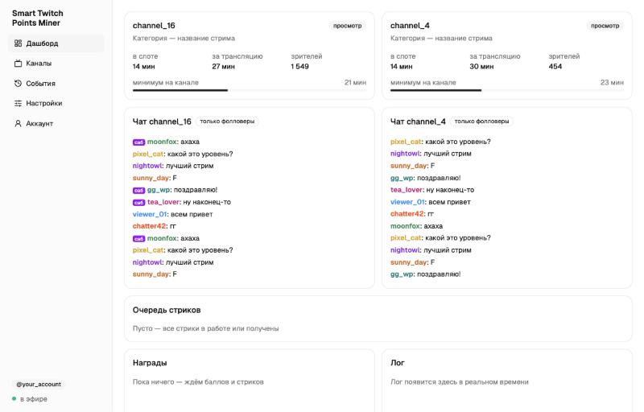
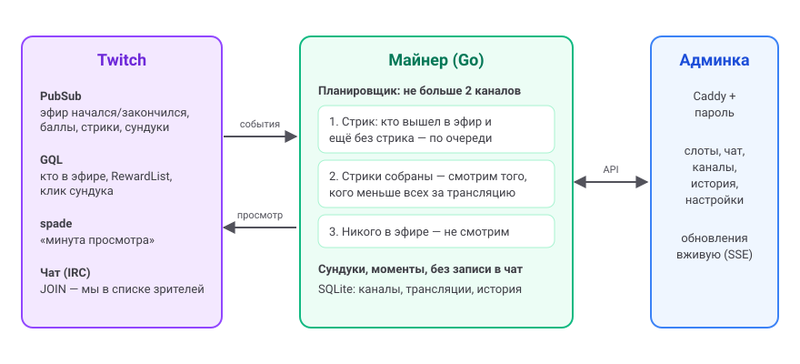
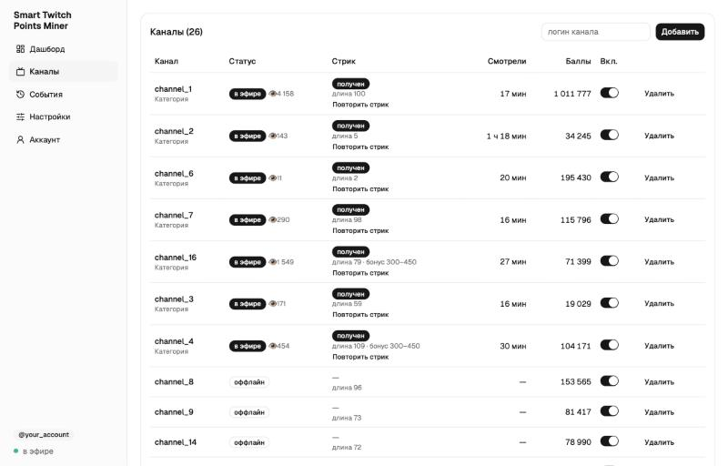
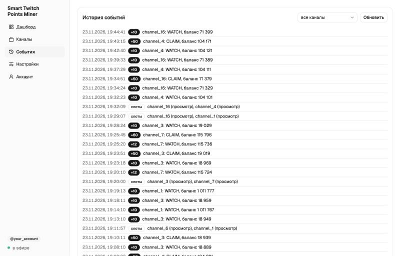
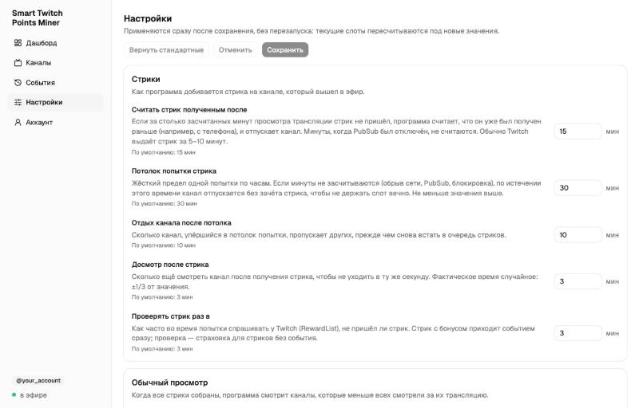

# Smart Twitch Points Miner

Бот, который сам собирает **стрики просмотра** (watch streak) на выбранных каналах Twitch и при этом
выглядит как обычный зритель: смотрит не больше двух стримов одновременно, сидит в их чатах (ничего не
пишет), делает человеческие паузы и не шлёт лишних запросов. Баллы канала и сундуки — попутно.



## Что умеет

- **Ловит стрики.** Узнаёт о начале стрима, смотрит канал, пока Twitch не выдаст стрик, и переходит к
  следующему. Если стрик уже взят с другого устройства — канал пропускается.
- **Не наглеет.** Не больше 2 каналов и 2 чатов, случайные интервалы, все запросы к Twitch пакетами,
  в чат — ни слова.
- **Не простаивает.** Когда стрики собраны, смотрит канал, который меньше всех смотрели за трансляцию.
- **Собирает сундуки** на своих каналах (сундуки каналов, которые вы смотрите сами, остаются вам).
- **Админка** с живыми обновлениями: слоты, чаты, каналы, история, все таймеры с объяснениями.
- **Работает годами без присмотра:** переподключается после обрывов, следит за токеном, чистит старую
  историю, умеет ходить через прокси.

## Как это работает



| Каналы | История | Настройки |
|---|---|---|
|  |  |  |

## Запуск

```bash
cp .env.example .env   # впишите пароль админки (и прокси, если сеть режет Twitch)
docker compose up -d --build
```

Откройте http://localhost:8080 → **Аккаунт** → «Войти через Twitch» → введите код на twitch.tv/activate →
на странице **Каналы** добавьте каналы. Дальше бот работает сам.

`.env`:

| Переменная | Зачем |
|---|---|
| `MINER_ADMIN_USER`, `MINER_ADMIN_PASSWORD` | вход в админку (без пароля compose не запустится) |
| `MINER_PROXY` | необязательно: `socks5://…` или `http://…` для всего трафика к Twitch |

Таймеры (через сколько считать стрик полученным, минимум на канале, паузы перед сундуками и т.д.)
меняются на странице **Настройки** и применяются сразу.

## Устройство

Два контейнера: **Caddy** (админка, пароль, прокси API) и **Go-бэкенд** (движок, Twitch-клиенты, SQLite),
который наружу не открыт. Админка — React + shadcn/ui, команды — Connect RPC, живые обновления — SSE.

```bash
make run                 # Go-бэкенд на :8080
cd web && npm run dev    # админка на :5173 (пароль из .env подставляется сам)
make gen && make test    # кодогенерация (proto, sqlc) и тесты
```

Ещё полезное:

- **Доступ снаружи** — в `web/Caddyfile` замените `:8080` на свой домен и уберите `auto_https off`: Caddy сам
  получит HTTPS (без него пароль админки идёт открытым текстом).
- **Логи** — `docker compose logs -f miner`; рутину (каждая минута просмотра, запросы) покажет
  `MINER_LOG_LEVEL=debug`.
- **Отладка трафика** — `MINER_TRACE_DIR` пишет сырой обмен с Twitch (см. закомментированные строки в
  `compose.yaml`), разбор — `scripts/trace_report.py`.

Подробнее: [PLAN.md](PLAN.md) — правила и архитектура, [docs/twitch-traffic.md](docs/twitch-traffic.md) —
что присылает Twitch (разбор трафика).
